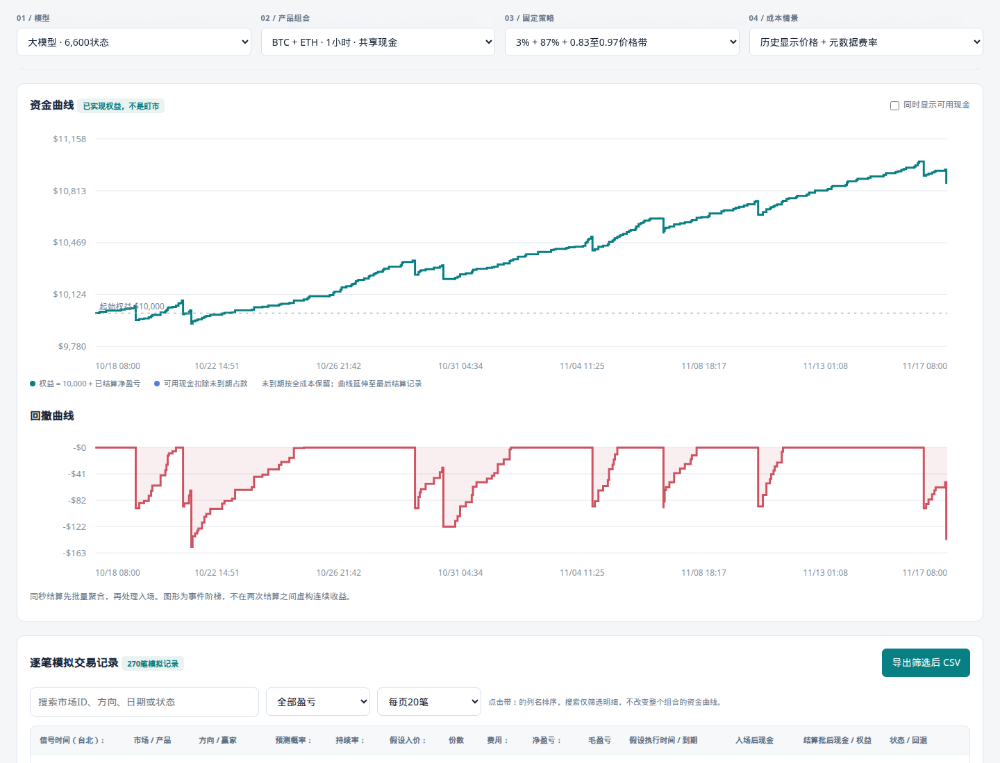
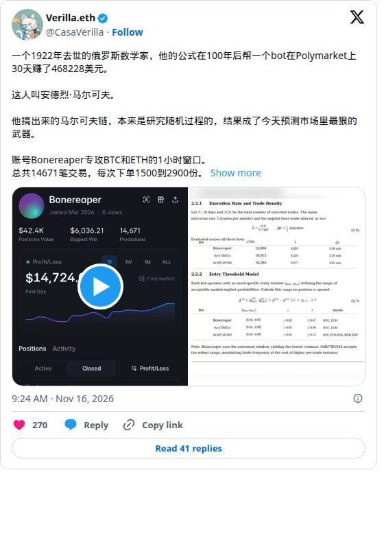

# MythBusters: Trading Edition

[简体中文](README.zh-CN.md)

**Your feed says it works. Does the backtest agree?**

We take trading methods circulating on social media, turn their claims into rules we can test, and publish the evidence so readers can rerun the backtest and see what drives the result.

Each case starts with the original post and a testable claim. We document how signals become trades, the data source and period, fees and slippage assumptions, and the pass criteria. The report shows the net result, drawdown, and benchmark when relevant. The verdict applies to the claim under the tested conditions.

## Backtest log

This repository now keeps one CasaVerilla study: the annual target was not met, and the actual run is 30 days of training plus 30 days of testing. The earlier 3-day and 7-day directories are not in the tree and are not published. Notes: [casa-verilla-markov](casa-verilla-markov/README.md).

The report page is [report.html](https://yisonchai.github.io/MythBusters-Trading-Edition/report.html). The same file is also served as [REPORT.html](https://yisonchai.github.io/MythBusters-Trading-Edition/REPORT.html) and at the site root. GitHub's Pages workflow publishes only that static file, not `data/`. Opening the lowercase and uppercase names does not depend on the web server's case folding.

| Source | Backtest data and code | Backtest results | Verdict |
| --- | --- | --- | --- |
| [CasaVerilla](https://x.com/CasaVerilla/status/2122259548102656341): annual target unmet, actual 30-day train and 30-day test | [src](casa-verilla-markov/03-annual-target-unmet-30d-test/src) · [data](casa-verilla-markov/03-annual-target-unmet-30d-test/data) · [protocol](casa-verilla-markov/03-annual-target-unmet-30d-test/研究协议.md) | [Report](https://yisonchai.github.io/MythBusters-Trading-Edition/report.html). Train 2026-09-17 08:00 to 2026-10-17 08:00 Taipei (1436/1440); test 2026-10-18 08:00 to 2026-11-17 08:00 (1434/1440). The page opens on the large 6,600-state model, BTC+ETH, 3% edge + 87% persistence + 0.83–0.97 band, and metadata fees: 270 trades and +$865.76. A 5-minute delay plus 2 cents on that same strategy is 131 trades and −$46.20. This is a quote proxy, not an executable fill. 33.05% of test markets were previously evaluated and 86.61% were previously downloaded. The market-price baseline still has the better Brier score. `data/raw/alternatives/` was not a model input. | confirm |

`confirm` in this row means the study is in the repository and the figures above were checked against `results.csv`. It does not mean the original post's one-year training, the claimed monthly profit, or a stable executable edge was verified.

Each completed case gets a verdict stamp in the last column. This row uses the literal status `confirm` with the narrower meaning above. The stamps below keep their existing definitions and are not the status of this row.

| Stamp | What it means |
| --- | --- |
|  | The evidence supports the claim under the stated test conditions. |
|  | The results contradict the claim under the stated test conditions. |
|  | The available evidence cannot settle the claim. |

## 回测曲线

Default view of the published report: large 6,600-state model, BTC+ETH shared cash, 3% edge + 87% persistence + 0.83–0.97 band, metadata-fee quote proxy. The curve is realized equity from $10,000, not a mark-to-market path. Screenshot time: 2026-11-17.

The same strategy loses $46.20 after a 5-minute delay and 2 cents. That stressed result stays available in the cost menu and is not the curve above.

## Source post

Direct request to <https://x.com/CasaVerilla/status/2122259548102656341> returned HTTP 403 in an unauthenticated browser. The image below is a screenshot of X's official embed at `https://platform.twitter.com/embed/Tweet.html?id=2122259548102656341`, taken 2026-11-17T14:51:05Z. It is not a capture of the full post page, and the embed still shows its own "Show more" control.

