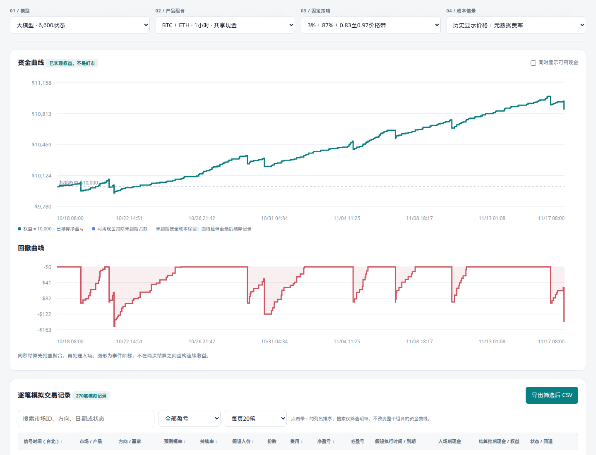
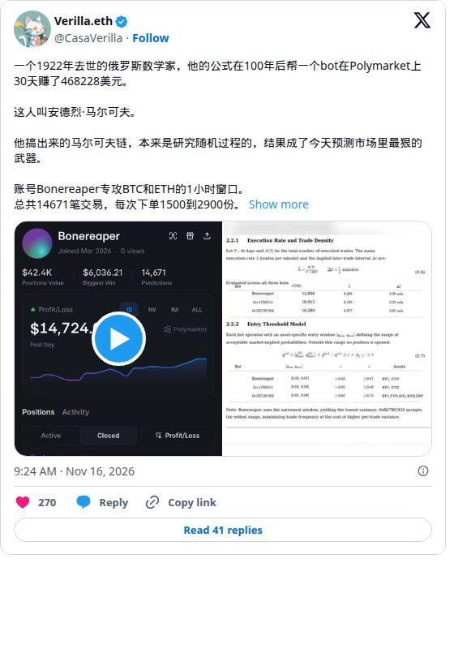

# 流言终结者-交易版

[English](README.md)

**社交媒体上都说这招有效。放进回测里，还成立吗？**

我们把社交媒体上流传的交易方法写成可以执行和检验的规则，公开原帖、回测数据来源、代码和结果，让读者能自己复跑，看看结论是怎么得出的。

每个案例从原帖和一条可检验的主张出发，记录信号何时触发、交易如何执行、数据来源与样本区间、费用和滑点假设，以及预先设定的判定标准。报告给出扣除交易成本后的结果、回撤，并在适用时提供对照基准。结论适用于该次回测所列的条件。

## 回测记录

本仓库现在只保留 CasaVerilla 的这一次研究：年度目标未达，实际是 30 日训练加 30 日测试。此前的 3 日和 7 日目录不在树里，也不会被发布。说明见 [casa-verilla-markov](casa-verilla-markov/README.md)。

预定报告地址是 [report.html](https://yisonchai.github.io/MythBusters-Trading-Edition/report.html)。同一文件也名为 [REPORT.html](https://yisonchai.github.io/MythBusters-Trading-Edition/REPORT.html)，并复制到站点根路径。工作流只发布这份静态报告，不发布 `data/`。

2026-11-17 这次部署没有上线。`actions/deploy-pages` 返回 HTTP 404，因为 GitHub Pages 尚未启用；用当前令牌调用启用接口返回 HTTP 403。在管理员把 [Settings → Pages](https://github.com/YisonChai/MythBusters-Trading-Edition/settings/pages) 设为 GitHub Actions 之前，上面的地址会 404。仓库里的文件是 [REPORT.html](casa-verilla-markov/03-annual-target-unmet-30d-test/REPORT.html)。

| 来源 | 回测数据和代码 | 回测结果 | 最终结论 |
| --- | --- | --- | --- |
| [CasaVerilla](https://x.com/CasaVerilla/status/2122259548102656341)：年度目标未达，实际30日训练、30日测试 | [src](casa-verilla-markov/03-annual-target-unmet-30d-test/src) · [data](casa-verilla-markov/03-annual-target-unmet-30d-test/data) · [协议](casa-verilla-markov/03-annual-target-unmet-30d-test/研究协议.md) | [报告](https://yisonchai.github.io/MythBusters-Trading-Edition/report.html)。训练 2026-09-17 08:00 至 2026-10-17 08:00 台北（1436/1440），测试 2026-10-18 08:00 至 2026-11-17 08:00（1434/1440）。页面打开时是大模型 6600 状态、BTC+ETH、3% 差值 + 87% 持续率 + 0.83 至 0.97 价格带、元数据费率：270 笔、+865.76 美元。同一策略在延迟 5 分钟再加 2 美分时为 131 笔、−46.20 美元。这是报价代理，不是可执行成交。测试市场 33.05% 此前已评估，86.61% 此前已下载。市场价基线的 Brier 仍然更好。`data/raw/alternatives/` 未入模。 |  |

这一行的「验证为真」印章表示本次研究可以复核，并且上面的报价代理数字与 `results.csv` 一致。它不表示完成了年度训练，也不表示原帖的稳定盈利或月收益已被证实。下方图例写的是：在所列回测条件下，证据支持原主张。这个图例比本行更宽。本行记录的是上面的报价代理结果，其中包括延迟后净亏 46.20 美元，并不把原帖主张当成已被支持。

完成的案例会在最后一列盖上判定章。

| 印章 | 含义 |
| --- | --- |
|  | 在所列回测条件下，证据支持原主张。 |
|  | 在所列回测条件下，结果与原主张相矛盾。 |
|  | 现有证据不足以判定真假。 |

## 回测曲线

发布报告的默认画面：大模型 6600 状态，BTC 与 ETH 共享现金，3% 差值 + 87% 持续率 + 0.83 至 0.97 价格带，元数据费率下的报价代理。曲线是从 10000 美元起的已实现权益，不是盯市。截图时间：2026-11-17。

同一策略在延迟 5 分钟并加 2 美分后净亏 46.20 美元。该压力结果仍可在成本菜单里看到，不是上面这条曲线。

## 来源帖

未登录浏览器直接请求 <https://x.com/CasaVerilla/status/2122259548102656341> 得到 HTTP 403。下图是 X 官方嵌入页 `https://platform.twitter.com/embed/Tweet.html?id=2122259548102656341` 的截图，时间 2026-11-17T14:51:05Z。它不是完整帖子页面，嵌入页自己的 “Show more” 仍在。

